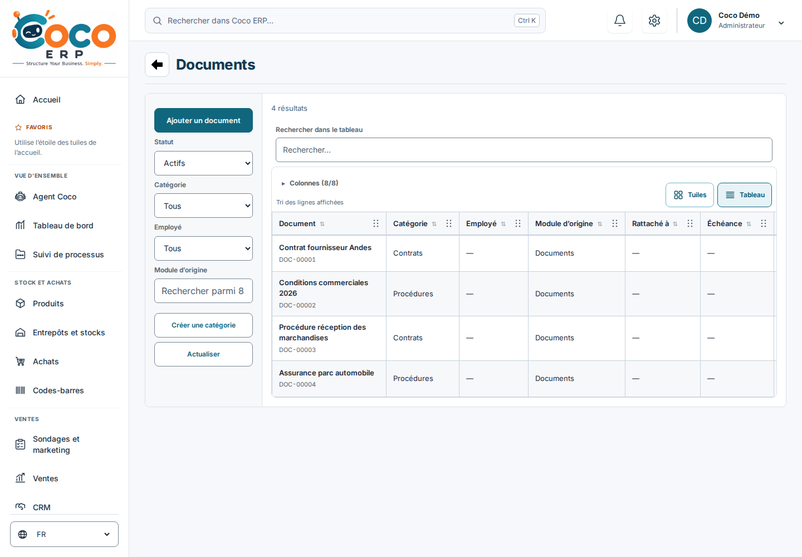
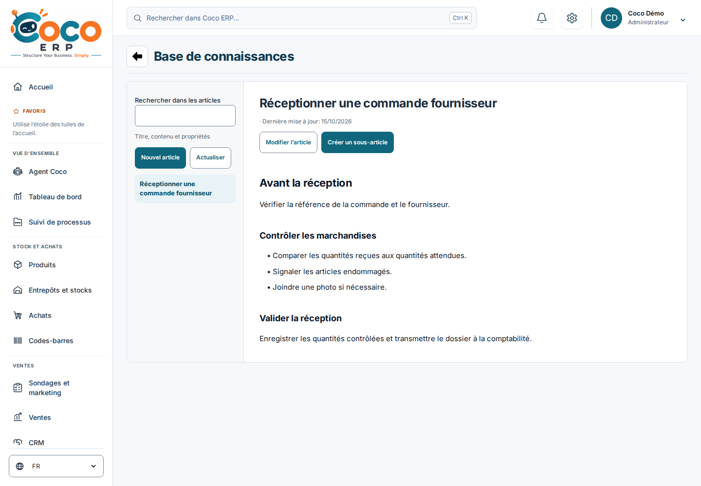

# Références visuelles

Les références du catalogue « Coco ERP — Références visuelles Odoo » du 15 octobre 2026 sont identifiées dans `sources.json`, avec URL officielle et empreinte du fichier consulté. Les captures Odoo restent dans le catalogue de recherche remis au propriétaire ; elles ne sont pas distribuées dans l’application. Aucun logo, pictogramme, texte produit ni code Odoo n’est ajouté au runtime.

Les captures avant/après de Coco utilisent exclusivement les fixtures locales et des données de démonstration. Le rapport de validation décrit les parcours vérifiés ; une capture n’est pas une preuve de fonctionnement serveur.

## Aperçus de l’implémentation

| Écran | Avant | Après |
| --- | --- | --- |
| Produits | [Avant](before-products.png) | [Catalogue en premier](coco-products.png) |
| Documents | [Avant](before-documents.png) | [Rail de filtres](coco-documents.png) |
| Base de connaissances | [Avant](before-knowledge.png) | [Surface de lecture](coco-knowledge.png) |

Autres aperçus : [Ventes](coco-quotes.png), [CRM](coco-crm.png), [Dashboard](coco-dashboard.png), [composants isolés](coco-primitives.png), [Documents mobile](coco-documents-mobile.png) et [article mobile](coco-knowledge-mobile.png).

### Documents

### Base de connaissances

